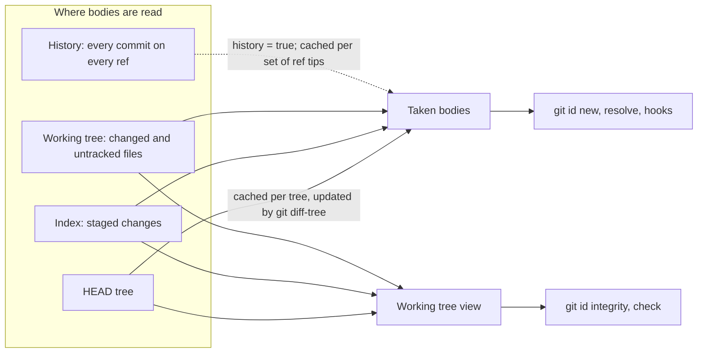

# git id

Stable IDs for documents that refer to each other: requirements, decisions, specs, knowledge bases. `git id` mints IDs that no one in the repository has used, resolves placeholders written by people and coding agents, and checks that every reference has exactly one definition.

```markdown
## [R-kNzgST] Exports retry on timeout

The retry policy of R-kNzgST also applies to imports.
```

An ID is a registered prefix, a separator and a random body ending in check characters. It is written in brackets where it is defined and bare where it is referenced, so a plain text file is enough: no database, no server.

- Random, not sequential: sequential numbers collide as soon as two branches add items at once. Minting checks every ID the repository has, and redraws on a hit.
- Checksummed: an ID typed by hand or made up by an agent fails the check, and so does every single-character typo and every swap of neighbouring characters.
- Configurable: the prefixes, the length of an ID and of its check, how definitions and references are written, and which files count are all set in `.git-id.toml`. A wider format can be added as the project grows, and every existing ID stays valid.
- Cached for large repositories: results are kept per tree and updated from `git diff-tree`, so after a commit only the changed files are read again.

## Why now

As coding agents take on more of the work, more of a project's knowledge lives in its repository, next to the code it describes. Requirements, decisions and specs are written in Markdown, reviewed in pull requests, and read and updated by agents along with the code.

How those documents point at each other has no settled answer yet:

- Links to file paths and headings break when a document is renamed or restructured.
- Sequential numbers collide when two branches add items at once.
- IDs from an issue tracker live outside the repository, so nothing in it can check them.

git id gives each item an ID written in the text itself. The ID survives renames and restructuring, is unique among everything the repository holds, and is checked with nothing but git.

## Install

With [Homebrew](https://brew.sh):

```sh
brew install --cask creasty/tools/git-id
```

With the install script, on macOS and Linux:

```sh
curl -fsSL https://raw.githubusercontent.com/creasty/git-id/main/install.sh | sh
```

It installs the latest release in `~/.local/bin`, after checking it against the release's checksums; `sh -s -- 0.1.0` in place of `sh` installs that version instead. A version already installed is left as it is, so the script can run at the start of every agent session or CI job. There it makes sure `~/.local/bin` is on `PATH` for the later steps of a GitHub Actions job, through `$GITHUB_PATH`, and for the shell commands Claude runs later in a Claude Code session, through `$CLAUDE_ENV_FILE`.

In GitHub Actions, on Linux and macOS runners:

```yaml
- uses: creasty/git-id@v0.2.0
```

It runs the install script for the version of the release tag it is pinned to, so a bot that bumps the tag upgrades git id with it. Pinned another way, such as by a commit, it needs the version given: `with: { version: 0.2.0 }`.

Or download the archive for your platform from [Releases](https://github.com/creasty/git-id/releases), or build with Go:

```sh
go install github.com/creasty/git-id@latest
```

With `git-id` on `PATH`, git runs it as `git id`. git turns `git id --help` into a man page lookup, so use `git id help`.

## Quick start

Create `.git-id.toml` at the root of the repository:

```toml
[prefixes]
R = { value = 0, description = "requirement" }
D = { value = 1, description = "decision" }

[[format]]
body = 6
checksum = 1
```

Mint an ID, write its definition, and refer to it:

```console
$ git id new R
R-kNzgST
```

Check the repository in CI, and require branches to be up to date before merging, so the check sees IDs minted on the base branch in the meantime:

```console
$ git id integrity
docs/export.md:3: W5 R-kNzgST unreferenced definition
0 errors, 1 warning
```

## Checks

`git id integrity` reads the working tree and exits 1 on any error; warnings are reported only. A code's letter is its severity, E for an error and W for a warning, and its number is the rule broken: E4 and W4 are the same failure, found where an ID is or is not surely meant.

| Code | Finding | Broken invariant |
|---|---|---|
| E1 | Stray reference | It has no definition |
| E2 | Duplicate definition | It is defined more than once |
| E3 | Unresolved placeholder | It still needs an ID |
| E4 | Invalid definition | It fails the checksum: typed by hand, or mistyped |
| W4 | Suspect reference | It fails the checksum; may be an ordinary word like `X-series` |
| W5 | Unreferenced definition | Nothing refers to it; often fine |
| E6 | Unmarked ID | It fits no template of the [notation](#your-own-notation) |

Findings come place first, as compilers write them, so terminals, editors and CI logs link the place. A finding with more places lists them on indented lines below its own. Errors come before warnings, each in path order, and the counts go to stderr:

```console
$ git id integrity
docs/decisions.md:12: E2 R-viA85w duplicate definition
  docs/retired.md:3: also defined here
docs/export.md:3: W5 R-kNzgST unreferenced definition
1 error, 1 warning
```

## Commands

| Command | |
|---|---|
| `git id new [<prefix>] [-n <count>]` | Mint IDs in the newest format |
| `git id check <id>... [--json]` | Where each ID is defined and referenced; for one written nowhere in the working tree, `reserved` (minting still avoids it) or `unused` |
| `git id resolve [<path>...]` | Replace human placeholders in the working tree and report what is left; `--dry-run` prints without writing, `--all` takes agent placeholders too |
| `git id integrity` | Run the checks; exit 1 on errors |
| `git id harvest` | Bring the caches up to date and print how many bodies are taken |
| `git id hook run claude\|codex` | Resolve agent placeholders in a `PreToolUse` hook |
| `git id hook install claude\|codex` | Add that hook to the project's agent settings (see [Hooks](#hooks)) |
| `git id --skill-instructions` | Describe this repository's IDs for an agent: prefixes, shape, notation, placeholders (see [Skill](#skill)) |

`resolve` replaces only the ID: brackets, line endings and every other byte of the file stay as they were. Its slot assignments last for one run, `--all` included: an agent slot that the hook already resolved elsewhere gets a different ID here, which integrity then reports as E1.

## Notation

By default (a repository can [write its own](#your-own-notation)):

| Written | Meaning |
|---|---|
| `[R-kNzgST]` | Definition: in brackets, exactly once in the repository |
| `R-kNzgST` | Reference: bare |
| `[R-kNzgST](url)`, `[R-kNzgST]: url`, `[[R-kNzgST]]` | Markdown links, reference definitions and wiki links are references |
| `[R-000000]`, `[R-000001]` | Placeholders, replaced by real IDs (below) |

An ID is found wherever it is not glued to a longer word: the character before and after it must not be an ASCII letter, digit or `_`. Anything else may touch it, so IDs inside prose that has no spaces between words (`仕様R-kNzgSTを参照`) are found too.

### Placeholders

Writing a definition and its references in one go, without minting first, takes placeholders. A placeholder is as wide as a body, starts with `0` or `1`, which no body contains, and is written in the notation like an ID:

- `[R-000000]`: a new definition. Every occurrence becomes a different ID. Anywhere but a definition it would refer to nothing, so it is reported and left as it is.
- `[R-000001]` with `R-000001`: a slot. Every occurrence of the same number becomes the same ID, so a definition and its references can be written apart.

The first digit says who resolves it:

| First digit | Resolved by | Slots last |
|---|---|---|
| `0` | a person running `git id resolve` | for that run |
| `1` | the agent hook, before an edit is written | for the agent's session |

They are kept apart because the two carry assignments differently: a person resolves once, right after writing; an agent writes across many edits, and must be told what each placeholder became, or it keeps using the placeholder.

### Retiring an ID

A retired ID keeps its definition, written somewhere exactly once: that keeps references to it valid and keeps it taken. Either keep it in place, struck through, when its content still matters:

```markdown
## ~~[R-kNzgST] Exports retry on timeout~~

Dropped: exports are now idempotent.
```

or move it when it does not, to a list or into the item that absorbed it:

```markdown
Retired: [R-kNzgST], [R-viA85w]
```

```markdown
## [R-eCtoQ4] Transfers retry on timeout

Absorbs [R-kNzgST].
```

With the default notation, a colon or parenthesis right after the closing bracket makes a link (`[R-kNzgST]: dropped` is a reference), so write the reason after a space or a dash.

## Configuration

`.git-id.toml` lives at the root of the working tree. Unknown keys are errors, and formats and prefix values have no defaults, since IDs cannot be renamed once written.

```toml
separator = "-"
history = false
include = ["**"]
exclude = []

[prefixes]
R = { value = 0, description = "requirement" }
D = { value = 1, description = "decision" }

[[format]]
body = 6
checksum = 1
```

| Key | Default | |
|---|---|---|
| `separator` | `"-"` | Between prefix and body. No letters, digits, `_`, whitespace or `[]():\|` |
| `history` | `false` | Also avoid every body in any commit on any ref when minting (see [History](#history)) |
| `include` | `["**"]` | Files read, as [glob patterns](https://github.com/bmatcuk/doublestar#patterns) relative to the root |
| `exclude` | `[]` | Files skipped among those included |
| `[prefixes]` | none | The kinds of ID: name → `value` and `description` |
| `[[format]]` | required | The shapes of the body, oldest first |
| `[notation]` | brackets define, bare refers | How definitions and references are written (see [Your own notation](#your-own-notation)) |

Files git treats as binary are skipped, by git's own rule: the `diff` attribute decides when it is set (`diff`, read as text) or unset (`-diff`, or the `binary` macro); otherwise a NUL in the first 8,000 bytes makes a file binary. Anything else is read as bytes, invalid UTF-8 included. To read a file git would call binary, give it the `diff` attribute in `.gitattributes`.

### Prefixes

A prefix is ASCII letters and digits; parts may be joined by the separator (`SHOP-CART-R`). The longest registered prefix wins, so `R` and `REQ` can coexist.

`value` is what the prefix adds to the checksum, which is how an ID pasted under the wrong prefix gets caught. It is required when a format has a checksum, must be unique, and must stay below $57^c$ for the smallest checksum length $c$ in use: up to 57 prefixes with one check character, 3,249 with two. Never change a value once IDs exist; `description` is for people and agents choosing a prefix.

Without `[prefixes]`, an ID is its body alone, and git id guarantees uniqueness only. A body cannot be told apart from an ordinary word: 1 in 57 words passes a one-character checksum (`SELECT`, `Number` and `cursor` do). So `git id new` avoids every word in the repository that is a valid body, which costs a few bodies and never a collision, while the notation, placeholders, the checks and the hooks need a prefix: `integrity`, `check` and `resolve` refuse to run, and the hooks leave such repositories alone. `separator` and `[notation]` are then errors, as there is nothing to separate or mark.

### Formats

`body` is how many characters the body has, check characters included, at least 2. `checksum` is how many of the last ones are check characters, from 0 up to `body - 1`.

The last format mints new IDs; every format stays valid, so the formats are told apart by width and no two may share one. To grow, append a format:

```toml
[[format]]
body = 6
checksum = 1

[[format]]   # from now on
body = 8
checksum = 2
```

Placeholders of any width are recognised and resolve to the newest format, so old notes and habits do not leave placeholders behind.

### Your own notation

`[notation]` lists the ways a definition and a reference are written, as templates: literal text around `{id}`, with a leading `^` for the start of a line. Each ID takes the role of the longest template that fits around it, which is how `[R-kNzgST](url)` fits `[{id}](` before it fits `[{id}]`. The defaults are the table in [Notation](#notation):

```toml
[notation]
definitions = ["[{id}]"]
references = ["{id}", "[{id}](", "[{id}]:", "[[{id}]]"]
```

A template can also say what its form is for, and that is what people and agents read when they pick one: `git id --skill-instructions` lists every form with its description, most common first, and the [skill](#skill) shows that list to the agent. A repository that defines IDs in headings and table rows, and refers to them with wiki links only:

```toml
[notation]
definitions = [
  { template = "^### {id} ", description = "a rule: a third-level heading, the rule in one sentence after the ID" },
  { template = "^| {id} |", description = "a finding: the first cell of a row in a findings table" },
]
references = [
  { template = "[[{id}]]", description = "a link to an item, from anywhere" },
  { template = "[[{id}|", description = "the same link with its own label, [[ID|label]]" },
]
```

A list left out keeps its default. Without a bare `{id}` template, an ID that fits no template is written outside the notation: an error (E6) when it passes the checksum, and a warning (W4) when it fails it, as it may be an ordinary word. Two templates of different roles must never tie: when both could fit one ID, one has to ask for more of the text around it.

### History

With `history = false`, minting avoids what HEAD, the index and the working tree contain. A body that was committed and later deleted can then be minted again; if it was published, keep it retired (see [Retiring an ID](#retiring-an-id)) so it stays taken.

With `history = true`, minting also avoids every body in any commit reachable from any ref: local and remote-tracking branches, tags and HEAD. That covers IDs deleted since, and IDs on branches you have fetched, which shrinks the window in which two branches can mint the same ID. The first run reads the whole history once; later runs read only the commits added since.

Any commit means every commit on a branch, not only the result that lands when it merges. An ID added in one commit of a pull request and removed in the next counts as long as that branch exists, here or on a remote you fetch, even though a squash merge leaves no trace of it.

Bodies found on a ref stay taken after the ref is deleted, in the clones that saw them: a clone that fetched the branch keeps avoiding them, while a fresh clone does not. Deleting `.git/git-id/history.json` makes a clone forget them. Clones can therefore differ, but only in avoiding a few extra bodies, which never risks a collision.

History changes only two things: what minting avoids, and the answer `git id check` gives for an ID written nowhere in the working tree (`reserved` rather than `unused`). `git id integrity` reads the working tree alone, so an ID found only on another branch is not a finding by itself. A reference to it is E1 until its definition reaches your tree. Two branches that minted the same ID show E2 once both definitions are in one tree: in CI, on a pull request kept up to date with the base branch.

## Agent integration

### Hooks

With a hook, an agent writes placeholders and the hook mints the IDs before the edit lands, then tells the agent what each became. Edits that break the notation (a fresh placeholder used as a reference, a human placeholder, a hand-written definition) are denied with the reason. In repositories without `.git-id.toml` or without prefixes, and in files git id does not read (outside `include`, or binary), the hook does nothing, so it can be installed globally.

Install it into the repository's project settings, one agent at a time:

```sh
git id hook install claude
git id hook install codex
```

Each adds the entry below to `.claude/settings.json` or `.codex/hooks.json` at the root of the working tree, creating the file if needed, and keeps the rest of it as it was. A file that already runs the hook is left untouched.

A rewrite approves nothing. For Claude Code the hook returns the new input without a permission decision, so the usual permission prompts apply. Codex accepts a rewritten input only with `allow`, and still runs its approval and sandbox checks afterwards. Codex also runs project hooks only once the project and the hook are trusted; until then placeholders are written as they are, and integrity reports them as E3.

Claude Code, in `.claude/settings.json`:

```json
{
  "hooks": {
    "PreToolUse": [
      {
        "matcher": "Edit|Write|MultiEdit|NotebookEdit",
        "hooks": [{ "type": "command", "command": "git id hook run claude", "timeout": 30 }]
      }
    ]
  }
}
```

Codex, in `.codex/hooks.json` (only added lines of a patch are resolved; context and removed lines must match the file as it is):

```json
{
  "hooks": {
    "PreToolUse": [
      {
        "matcher": "apply_patch",
        "hooks": [{ "type": "command", "command": "git id hook run codex", "timeout": 30 }]
      }
    ]
  }
}
```

Edits without a placeholder run no git command; an edit to resolve or deny first asks git whether the file is binary. Slot assignments are kept per session in the OS temporary directory.

### Skill

[`skills/git-id`](skills/git-id/SKILL.md) teaches an agent the notation and the commands. Copy it to `.claude/skills/` for Claude Code or `.agents/skills/` for Codex.

What differs between repositories is not written in the skill: it runs `` !`git id --skill-instructions` ``, which Claude Code replaces with the command's output when the skill loads, so the agent reads this repository's prefixes, ID shape, notation (with each form's description) and placeholders as they are configured. An agent that does not expand the line is told to run the command itself. The skill's own examples use the prefix `X`; leave `X` unregistered so they never become live IDs.

## How it works



Minting reads three stages, because the working tree alone misses two cases: a definition deleted after it was committed, and staged content edited again since. The checks read the working tree only, because they ask whether what is written now is consistent.

The HEAD stage is cached in the worktree's git directory (`.git/git-id/head.json`), keyed by tree. When HEAD moves, only the paths `git diff-tree` reports are read again, unless a `.gitattributes` changed, which can change what is binary everywhere. The history is cached in the shared git directory, keyed by the ref tips it covered. Caches are ignored when the configuration or `.git/info/attributes` changes, and can be deleted at any time; delete them after changing global or system gitattributes, which they do not track.

git id never takes the index lock (it runs git with `GIT_OPTIONAL_LOCKS=0`), so its hooks cannot collide with your own `git add` or `git commit`. The cost shows right after a checkout: until something refreshes the index, `git status` re-reads every file written in the same second as the index. In one 1,000-file repository that was 0.9 s per run, and 0.01 s after a single `git status` or `git update-index --refresh`.

## Design

### The checksum

A body of $r$ random characters $`d_1 \ldots d_r`$ and $c$ check characters is valid when

```math
\left( v \cdot 2^{r+1} + d_1 \cdot 2^{r} + \cdots + d_r \cdot 2 + C \right) \bmod 57^{c} = 0
```

where $v$ is the prefix's value and $C$ is the check characters read as one base-57 number. The alphabet has 57 characters: ASCII letters and digits without the easily confused `0`, `O`, `1`, `I` and `l`. Because 57 is odd, every power of two is invertible modulo $57^c$, and so is the difference of any two neighbouring weights. That makes the check reject, with no exceptions:

- every single-character substitution,
- every swap of two neighbouring characters,
- a body paired with another registered prefix.

Any other string passes with probability exactly $1/57^c$, since each random part has one valid check value per prefix.

The check does not exist to catch typos so much as to answer, from the text alone, whether an ID came from the minter. IDs share documents with identifiers from elsewhere, and agents sometimes write a plausible random string instead of minting one. A definition that fails the check is an error (E4); a bare token that fails it is a warning (W4), since it may be an ordinary word. A made-up string that passes by luck still has no definition, and fails as E1.

### Collisions

Minting draws at random and redraws on a hit (rejection sampling), so an ID is unique among everything the minter can see, however large the repository. A hit there costs only a redraw: minting $n$ IDs out of $N$ possible bodies redraws about $n^2/2N$ times in total, 8 times over the first 100,000 IDs with five random characters. Two IDs can only collide silently when they are minted on parallel branches, each unaware of the other. For $k$ branches minting $m$ IDs each in that window, out of $N = 57^r$ possible bodies:

```math
\text{expected collisions} \approx \frac{k(k-1)}{2} \cdot \frac{m^2}{N}
```

With five random characters ($N \approx 6.0 \times 10^8$), ten branches minting 20 IDs a week each come to about 0.16% a year, and CI catches what remains as E2 before merging. The window starts at a branch's last sync with the others, not where it forked, so frequent rebases and small pull requests shrink it fastest: $m$ enters squared. `history = true` shrinks it further, to IDs on branches not fetched yet.

At these odds the implementation matters more than the arithmetic, which is why the minter uses a CSPRNG and checks the index and HEAD as well as the files: a time-seeded generator, or a check that misses a deleted definition, would be orders of magnitude worse. The most frequent duplicate has nothing to do with chance: copying a document to start a new one copies its IDs. Integrity reports it as E2.

## License

MIT
